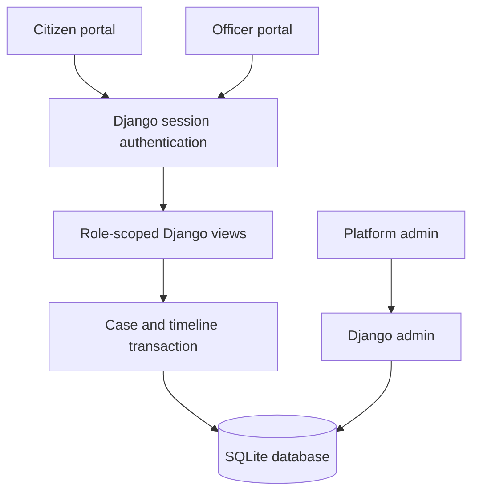

# Civic Desk — Python grievance portal

Requires Python 3.10+ and Django 5.2. From this directory:

    python -m venv .venv
    # Windows PowerShell: .venv\Scripts\Activate.ps1
    # macOS/Linux: source .venv/bin/activate
    python -m pip install -r requirements.txt
    python manage.py migrate --fake-initial
    python manage.py createsuperuser
    python manage.py runserver

The migration adds IT Department, Rent Complaint, and CA Department under the Civic Desk organization. Open http://127.0.0.1:8000/admin/ with the superuser. Under Users, create an ordinary account for each officer. Under Officers, assign each user to their department. Officers select their assigned department and enter their username and password at http://127.0.0.1:8000/officer/login/ to view that department's grievances. Reserve admin access for the platform operator.

Open http://127.0.0.1:8000/ and register a citizen with a first name, last name, mobile number, street address, city, state or region, postal code, username, and password. Registration signs the citizen in. Returning citizens sign in with their username and password. Submit a case to a department. Use another browser session for its officer. Start review, ask for clarification or resolve. The citizen can reply, accept the resolution, or return the case to In Progress with a reason. All case updates are visible to the citizen. The tracking number appears on the dashboard and case page.

## System architecture

## Database and project structure
Organization has many departments. Each officer account belongs to one department. A case belongs to one citizen and one department. Each case has a unique tracking UUID and many dated events. An event references its author. The department determines the organization. User and session records use Django's built-in tables.

settings.py configures the database and authentication. urls.py defines the two entrances and case routes. cases/models.py defines the schema, cases/views.py handles permissions and transitions, and templates/portal.html renders the pages.

## Reusable build prompt
Build a Python Django grievance portal for multiple organizations. Use Django templates, Django authentication, the ORM, and SQLite for local development. Provide separate citizen and officer logins. Citizens can self-register, choose an organization and department, file a grievance, receive a tracking number, read case history, reply, and accept or reopen a resolution. Officers are provisioned by a platform administrator and may review only grievances assigned to their department. Record updates and state transitions atomically. Enforce ownership and department scope for every case read and write. Include an architecture diagram, database relationships, setup instructions, and tests for cross-organization access and the citizen-to-officer workflow.

## Scope
Local starter. Attachments, private notes, notifications, supervisor assignment, and production deployment are future extensions. For an existing local database created with `migrate --run-syncdb`, run `python manage.py migrate --fake-initial` to adopt the initial migration and add the citizen profile table.
